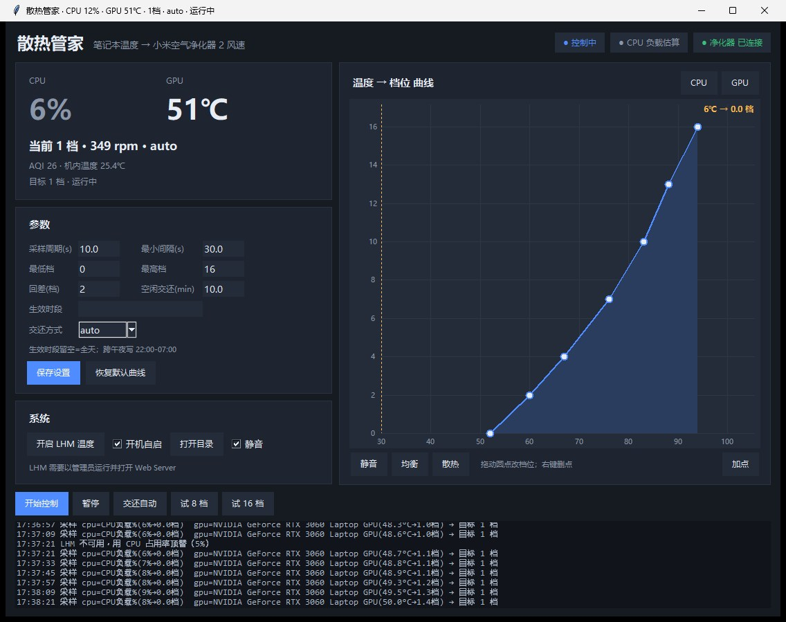

# 散热管家 · 用小米空气净化器给笔记本散热

> 一个开箱即用的 Windows 小应用：**读取笔记本 CPU/GPU 温度 → 自动调节小米空气净化器的风速**，
> 配合 3D 打印风道，让净化器变成笔记本的外置散热器。
>
> Zero third-party dependencies · Windows 10/11 · 需要一台支持 miIO 协议的小米空气净化器（如空气净化器 2）

[](https://github.com/WuY11111/purifier-bridge/releases/latest)
[](LICENSE)
[](https://github.com/WuY11111/purifier-bridge/actions/workflows/ci.yml)



```
 nvidia-smi (GPU 温度) ─┐
                        ├─→ 温度→档位 曲线 ─→ 平滑/回差/限流 ─→ UDP 54321 ─→ 净化器「最爱模式」
 LibreHardwareMonitor ──┘        （没有 LHM 时自动退化为 CPU 负载估算）
```

- **不经过米家云**，局域网直连设备（miIO 协议，AES-128-CBC）
- **零第三方依赖**：只用 Python 标准库，纯 Python 实现的 AES（有 NIST 向量自检）
- **图形界面**：实时温度、拖拽调曲线、开机自启、托盘常驻
- **会自愈**：Wi-Fi 掉线自动重连、净化器换 IP 自动重新发现、断网退避重试

---

## 快速开始

```powershell
git clone https://github.com/<you>/purifier-bridge.git
cd purifier-bridge
python app.py
```

首次运行会**自动在局域网里搜索净化器并写入 `config.json`**（需要和净化器在同一网段）。
找不到就执行 `python bridge.py discover` 手工确认，或按下面的「手工配置」填 IP/token。

想要 CPU 温度：安装 [LibreHardwareMonitor](https://github.com/LibreHardwareMonitor/LibreHardwareMonitor)（便携版解压到 `tools\LibreHardwareMonitor\`），
以管理员运行，并在 `Options → Remote Web Server → Run` 打开 8085 端口。
**不装也能用** —— CPU 那一路会自动退化成 CPU 占用率估算。

打包成免安装 exe：`powershell -ExecutionPolicy Bypass -File scripts\build.ps1`

### 手工配置

复制 `config.example.json` 为 `config.json`，填两处：

```jsonc
"purifier": {
  "ip": "192.168.1.23",        // 净化器在路由器里分到的地址
  "token": "xxxxxxxx...",      // 32 位十六进制，见下
  "wifi_profile": "你的Wi-Fi名" // 可选：断网时自动重连这个 Wi-Fi
}
```

**token 怎么拿**：`python bridge.py discover` 会直接打印（miIO 的握手回包里就带着 token）。
拿不到时可以用 `获取token-米家云.py`（登录米家账号读取），或者参考社区的 token 提取工具。

---

## 界面

| 区域 | 能干什么 |
|------|----------|
| 左上 | 实时 CPU / GPU 温度、净化器当前档位与转速、AQI |
| 右上 | **温度→档位曲线**：拖动圆点即改，松手自动保存；右键删点，「加点」新增；CPU/GPU 切换；底部 **静音 / 均衡 / 散热** 三套预设一键切换 |
| 左中 | 参数：采样周期、最小间隔、档位上下限、回差、空闲交还、生效时段 |
| 左下 | 开启 LHM 温度、开机自启、打开目录、静音 |
| 底部 | 开始控制 / 暂停 / 交还自动 / 试档 / 实时日志 |

- **关窗口 = 缩到托盘**（控制继续）；托盘图标悬停能看到实时状态，双击=打开窗口，右键=显示 / 暂停 / 三套预设 / 交还并退出
- 净化器掉线超过 5 分钟会弹气泡提醒
- **静音**：切档前自动关掉净化器提示音，交还时恢复原设置

---

## 曲线怎么调

曲线是折线：横轴温度（℃），纵轴档位（0~16），中间线性插值。CPU、GPU 各一条，**取两者算出的最大值**下发。

实测的「档位 ↔ 转速」（小米空气净化器 2）：

| 档位 | 1 | 2 | 3 | 4 | 6 | 8 | 10 | 12 | 14 | 16 |
|------|---|---|---|---|---|---|----|----|----|----|
| rpm | 700 | 744 | 799 | 851 | 1171 | 1401 | 1700 | 1903 | 1995 | 2099 |

档位**不是线性**的：1~4 档都在 700~850 rpm（安静区），6 档往上才明显加风量，14~16 档到顶。

参考实测（i7-12700H）：空载 48~51℃、全核满载 94~96℃、偶发 70+ 尖峰 —— 所以必须靠 EMA 平滑，
否则风扇会一惊一乍。默认曲线：

```
CPU: 52→0  60→2  68→4  76→7  83→10  88→13  94→16
GPU: 45→0  52→2  58→4  64→7  70→10  76→13  82→16
```

调参建议：觉得吵就把 60~70℃ 段往下压；觉得不够凉就抬高 76℃ 以上；**回差用 2**（用 1 会在 3↔4 档之间每 30 秒抖一次）。

---

## 参数

| 参数 | 默认 | 说明 |
|------|------|------|
| 采样周期 | 10 s | 多久算一次，最小 2 s |
| 最小间隔 | 30 s | 两条指令之间至少隔多久，保护电机 |
| 最低档 / 最高档 | 0 / 16 | 档位钳制（0 = 停转） |
| 回差 | 2 | 目标与当前档位差小于它就不动设备 |
| 空闲交还 | 10 min | 连续低于曲线下限这么久就交还 auto；0 = 从不 |
| 生效时段 | 空 | 例如 `09:00-23:00`，跨午夜写 `22:00-07:00` |
| 交还方式 | auto | `auto` 切回自动模式 / `off` 关机 / `keep` 不动 |

---

## 自愈与兜底

| 场景 | 行为 |
|------|------|
| Wi-Fi 不同网段 / 掉线 | 配置了 `wifi_profile` 就自动连接（wlanapi，不需要管理员），连上立刻恢复控制 |
| 净化器换了 IP（路由器重新分配） | 连不上时自动重新发现，按 MAC 认设备，改回配置 |
| 一直连不上 | 指数退避（20s→40s→…→300s），不刷屏 |
| 没有 LHM | CPU 一路自动退化为 CPU 占用率估算（`GetSystemTimes`），界面灰显，不报错 |
| 净化器断电 | 下次连上会自动开机并接管 |
| 程序崩溃/重启 | 开机自启（注册表 Run）+ 记住上次是否在运行 |

> 建议在路由器里给净化器做**静态 IP 绑定**，自愈要等一分钟，绑定后是秒连。

---

## 命令行

```powershell
python app.py                     # 图形界面
python app.py --silent            # 只跑后台控制（开机自启用这个）
python bridge.py discover         # 扫描局域网里的 miIO 设备（打印 IP/token/型号）
python bridge.py probe            # 列出本机可读的温度测点
python bridge.py status           # 净化器状态
python bridge.py once --dry-run   # 按当前温度算一次档位，不下发
python bridge.py run              # 纯命令行常驻
python bridge.py selftest         # 自检：AES 已知答案 + 假设备全链路（不需要真机）
```

---

## 开发

```
app.py           图形界面（tkinter）：视图、托盘、日志
bridge.py        控制器：曲线/回差/限流/交还/自愈 + miIO 设备封装 + 命令行
config.py        配置默认值、归一化（脏值收敛）、原子写
sampler.py       读传感器：LHM / nvidia-smi / CPU 负载，含兜底策略
miio_lan.py      miIO 协议 + 纯 Python AES（握手、发现、加解密）
sensors.py       温度源实现（LHM HTTP/WMI、nvidia-smi、GetSystemTimes）
tray.py          托盘图标（ctypes 调 Shell_NotifyIcon）
fake_purifier.py 假净化器，用于离线自检
scripts/build.ps1  PyInstaller 打包
tools/           压测、A/B 对照、截图、连 Wi-Fi 等小工具（开发用）
```

- 依赖：**无**（Python 3.10+，标准库即可）
- 自检：`python bridge.py selftest`（AES 已知答案 + 假设备全链路）
- 静态检查：`ruff check --select F,E9 .`
- 打包：`scripts\build.ps1` → `dist\PurifierApp\`

---

## 已知限制

- 只验证过 `zhimi.airpurifier.m1/m2` 系列；其他型号（Pro / 3 / 4）档位指令可能不同，需要改 `set_level_favorite`
- 风扇控制是**曲线映射**，不是恒温闭环（没有"目标温度"概念）
- 唯一需要手动的地方：LHM 的 Web Server 开关不持久，每次重启后要在它的菜单里点一次 `Run`
  （不点也不影响使用，只是 CPU 温度变成占用率估算）
- Windows 上读真实 CPU 温度必须经过管理员权限的内核驱动，无法完全绕开

---

## 许可

MIT。`LibreHardwareMonitor` 是独立的第三方程序（MPL-2.0），本项目不分发它的二进制，
需要时请自行下载。

miIO 协议格式参考了 [python-miio](https://github.com/rytilahti/python-miio) 的公开实现说明，代码为独立实现。

> 本项目与小米公司无关，是一个个人使用的第三方工具；「小米」「米家」等商标归其所有者。
